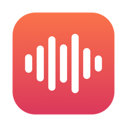
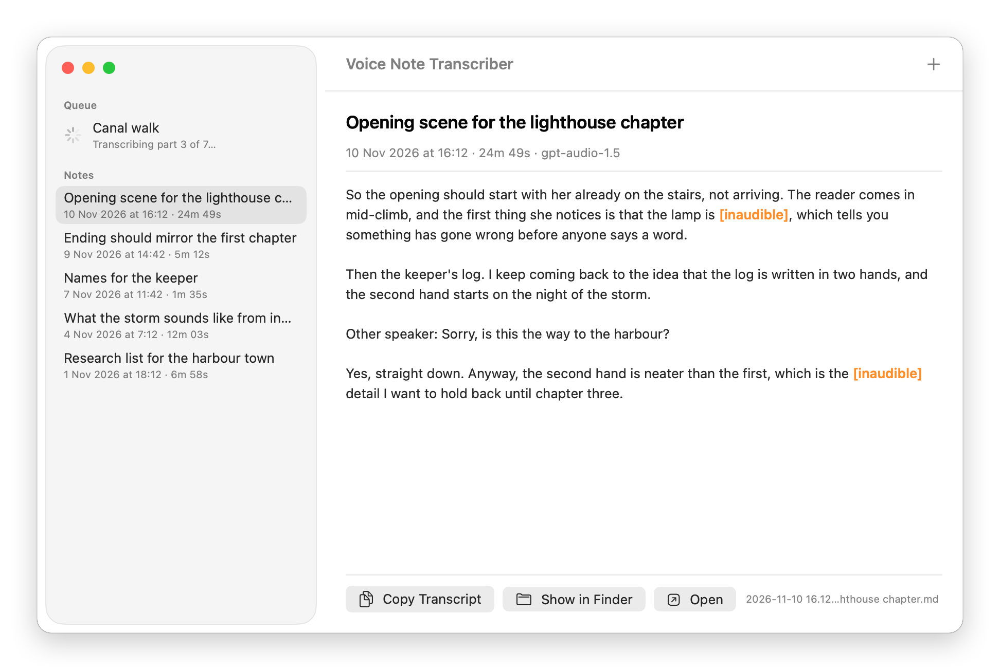
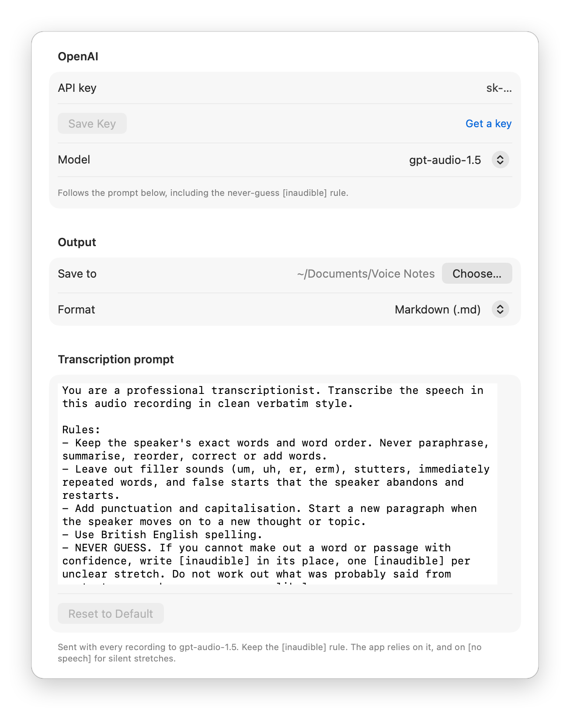
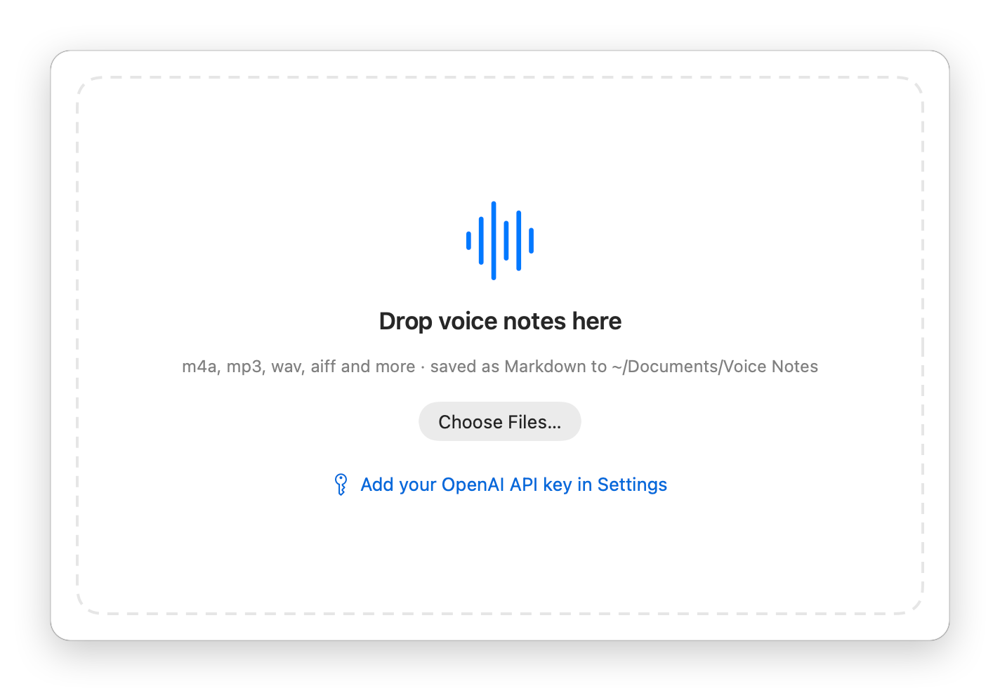

<p align="center">
  
</p>

<h1 align="center">Voice Note Transcriber</h1>

<p align="center">
  A tiny Mac app that turns voice notes into clean, careful transcripts.<br>
  Drop in an iPhone recording and get Markdown back. Anything it can't make out is marked <code>[inaudible]</code>, never guessed.
</p>

<p align="center">
  <a href="https://github.com/ruairidhflint/VoiceNoteTranscriber/actions/workflows/ci.yml"></a>
  
  
  
  
  <a href="LICENSE"></a>
</p>

<p align="center">
  <picture>
    <source media="(prefers-color-scheme: dark)" srcset="docs/images/note-dark.png">
    
  </picture>
</p>

## Features

- **Any audio, no converting.** m4a straight from Voice Memos, plus mp3, wav, aiff, caf, aac and the sound from mp4 or mov video.
- **Never guesses.** Words it can't make out become `[inaudible]`, highlighted so you know where to re-listen.
- **Clean verbatim.** Your words in your order, without the ums, stutters and false starts. Punctuated, in paragraphs, in British spelling. The prompt is yours to edit.
- **Long notes are fine.** Recordings are split at natural pauses, transcribed part by part and joined back together, so nothing is cut mid-sentence.
- **Named for you.** Each note gets a short AI title and its recording date: `2026-11-10 14.32 – Opening scene for the lighthouse chapter.md`. Edit the title to rename the file.
- **Your folder is the library.** Notes are plain Markdown or text files in a folder you choose. Rename or delete them in Finder and the app keeps up.
- **Your key, your account.** You bring an OpenAI API key; it's kept in the macOS Keychain. Audio goes to OpenAI to be transcribed and nowhere else.

## Install

**You need:** a Mac running macOS 26 Tahoe or later, [Xcode](https://apps.apple.com/app/xcode/id497799835) 26 (free) or just its command-line tools (`xcode-select --install`), and an [OpenAI API key](https://platform.openai.com/api-keys).

```sh
git clone https://github.com/ruairidhflint/VoiceNoteTranscriber.git
cd VoiceNoteTranscriber
./install.sh
```

The script checks your setup, runs the tests, builds the app, installs it in `/Applications` and opens it. The first build takes a minute or two.

Then add your key:



1. Open **Settings** (⌘,).
2. Paste your OpenAI API key and click **Save Key**.
3. Optionally, choose where notes are saved (`~/Documents/Voice Notes` by default) and whether they're Markdown or plain text.

That's it. Drop a voice note on the window.

<details>
<summary>Why do I build it myself instead of downloading an app?</summary>

A downloadable Mac app needs a paid Apple Developer ID and Apple notarisation, or macOS refuses to open it.
Building it yourself is free, takes a minute, and gives you an app signed on your own Mac from source you can read.
</details>

<br clear="right">

## Using it

| To… | Do this |
|---|---|
| Transcribe a voice note | Drop it (or several, or a folder) on the window or the Dock icon. Or click **+**, or use Finder's **Open With** |
| Read an earlier note | Pick it in the sidebar. Every note in your notes folder is listed, newest first |
| Rename a note | Edit the title above the transcript and press Return. The file is renamed too |
| Copy the transcript | **Copy Transcript** (⇧⌘C) |
| Open it in your editor | **Open**, or right-click › **Open in Default App** |
| Retry a failed note | Select it and click **Retry** |
| Change the folder, format, model or prompt | **Settings** (⌘,) |

<p align="center">
  <picture>
    <source media="(prefers-color-scheme: dark)" srcset="docs/images/drop-dark.png">
    
  </picture>
</p>

## FAQ

<details>
<summary><b>What does a saved note look like?</b></summary>

A short details header, then the transcript:

```markdown
---
recorded: 2026-11-10 14:32
duration: 24m 49s
source: "New Recording 23.m4a"
model: gpt-audio-1.5
---

So the opening should start with her already on the stairs, not arriving. The reader comes in mid-climb, and the first thing she notices is that the lamp is [inaudible], which tells you something has gone wrong before anyone says a word.
```

Plain-text notes have the same details as `Recorded:`, `Duration:`, `Source:` and `Model:` lines.
</details>

<details>
<summary><b>Which model should I use?</b></summary>

- **`gpt-audio-1.5`** (the default) follows the prompt, so it writes clean verbatim and marks `[inaudible]` instead of guessing.
- **`gpt-transcribe`** is OpenAI's dedicated speech-to-text model. It's more literal word for word, but it can't follow instructions, so it won't mark `[inaudible]`.

Each note records which model wrote it. Switch in **Settings**.
</details>

<details>
<summary><b>What does it cost?</b></summary>

The app is free. OpenAI bills your account for the audio you send and the short title request; see [OpenAI's pricing](https://openai.com/api/pricing/).
</details>

<details>
<summary><b>Where does my audio go?</b></summary>

Your recording is converted on your Mac and sent to OpenAI's API, in parts, to be transcribed. [OpenAI's API data policy](https://platform.openai.com/docs/guides/your-data) covers what happens to it there.
Nothing else leaves your Mac: no account, no analytics, no telemetry. Your audio files are never moved or copied, and notes are saved only to your folder.
</details>

<details>
<summary><b>The recording date looks wrong</b></summary>

The date comes from the one the iPhone stores inside the recording, or the file's own date if there isn't one.
Some ways of sharing a recording rewrite it, so the date can be when the file was sent rather than when it was recorded. You can still rename the note however you like.
</details>

<details>
<summary><b>macOS asks whether the app can use the Keychain</b></summary>

Choose **Always Allow**. A self-built app gets a new signature each time it's rebuilt, so macOS asks once after each update before letting it read the key it saved.
</details>

<details>
<summary><b>How do I update or uninstall it?</b></summary>

- **Update:** `git pull && ./install.sh`
- **Uninstall:** `./install.sh --uninstall`. This removes the app, and asks before deleting your saved API key and settings. Your notes are kept.
</details>

## How it works

Audio is converted on your Mac to 16 kHz mono. Long recordings are split at natural pauses into parts of about four minutes.
Each part goes to OpenAI with the transcription prompt, and the parts are joined back together, given a title and saved with a details header.
It's written in Swift with no third-party dependencies.

Read [**docs/DESIGN.md**](docs/DESIGN.md) for the architecture, how the pause detection works, the prompt and the tests.

## Development

```sh
./install.sh --build-only                                        # test + build ./build/Voice Note Transcriber.app
swift test                                                       # 15 unit tests
swift run -c release transcriber-cli chunks ~/Downloads/note.m4a # where a recording would be split (offline)
./scripts/render-screenshots.sh                                  # re-render the images in docs/images
```

## License

[MIT](LICENSE) © 2026 Ruairidh Flint
